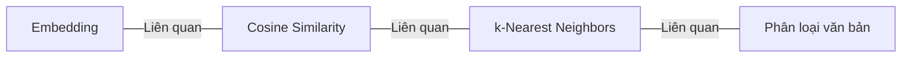

# Bộ dữ liệu Lab cho AI Knowledge Mapping

Bộ xuất gồm 14 Lab, 77 checkpoint hoặc phase và 165 mục bằng chứng. 148 mục trỏ đến file có trong commit nguồn.

[Dữ liệu JSON để backend nạp](labs.json)

## Mind map kiến thức và hướng dẫn checkpoint

[Knowledge Graph và phần giải thích soạn sẵn](knowledge-graph.json) có 65 khái niệm cơ bản và chuyên sâu. Các cạnh trong `graph.edges` nối hai khái niệm theo quan hệ kiến thức. Nguồn từ Lab nằm trong `lab_references`. Dùng `lecture_sources` để gắn bài giảng thật sau khi đối chiếu.

Khi học viên chọn một checkpoint, tra ID trong `checkpoint_views` để hiện mục tiêu, cách làm tổng quát, đầu ra và câu tự kiểm. Dùng `concept_ids` để lấy các node cần hiện và các cạnh nối chúng. `code_guides` chứa lời giải thích đã soạn cho các vị trí được chọn trong repo mẫu. Mỗi mục có nguồn và trạng thái của template.

Ví dụ ở `day01-cp2`, màn hình giải thích ngay hai cách biểu diễn và phân loại. Khi mở phần Embedding, học viên có thể lần từ vector sang độ tương đồng và kNN. Nếu học viên nhập repo bài làm, phần đọc repo lấy thêm bằng chứng từ chính commit đó để giải thích họ đã triển khai đến đâu.

## Cách dùng với GraphRAG

1. Dùng ID Lab và checkpoint để lấy yêu cầu, đầu ra dự kiến và vị trí cần đọc.
2. Ghim commit repo học viên, tìm file, cell hoặc hàm theo cấu hình rồi trích đoạn thực tế. Nếu file bài nộp khác template, kiểm lại locator trên bản nộp.
3. Dùng các khái niệm gợi ý để truy xuất. Đối chiếu ID node và trang với tài liệu Lecture trước khi xác nhận.
4. Dùng tài liệu, ví dụ và TODO để giải thích yêu cầu. Xác nhận APPLIED_IN khi có đoạn triển khai phù hợp.
5. Dùng sample_checks khi đánh giá. Giữ các kỳ vọng ở phía chấm.

Day 06 và 07 dùng ID nội bộ theo lịch. Day 12 có bốn phase theo README công khai, yêu cầu chi tiết cần Lab Board. Mốc slide Day 01 đến từ notebook và đang chờ đối chiếu Lecture gốc.

## Danh mục

| Lab | Chủ đề | Số mốc | Nguồn |
|---|---|---:|---|
| day01 | AI Foundation · Lọc SMS spam/ham | 3 | [Repo](https://github.com/VinUni-AI20k/K5-L3-Day-01-AI-Foundation-Lab) · [Mốc](https://github.com/VinUni-AI20k/K5-L3-Day-01-AI-Foundation-Lab/blob/e3b548168b0093ca9b0f7e75a35a1929ea1f48c8/CHECKPOINTS.md) |
| day02 | Discovery & Problem Framing | 8 | [Repo](https://github.com/VinUni-AI20k/K5-L3-Day02-DiscoveryProblemFraming) · [Mốc](https://github.com/VinUni-AI20k/K5-L3-Day02-DiscoveryProblemFraming/blob/354e210608aba861c696c1434835497831aa7efd/CHECKPOINTS.md) |
| day03 | Prompt Engineering & Tool Calling · Research Agent | 5 | [Repo](https://github.com/VinUni-AI20k/K5-L3-DAY03-ResearchAgentToolEval) · [Mốc](https://github.com/VinUni-AI20k/K5-L3-DAY03-ResearchAgentToolEval/blob/c68da4cdb50c118c9f00622bd72e6cd7afc57b18/CHECKPOINTS.md) |
| day04 | ReAct Loop · Status Investigation Agent | 7 | [Repo](https://github.com/VinUni-AI20k/K5-L3-Day4-ReactLoopAgent) · [Mốc](https://github.com/VinUni-AI20k/K5-L3-Day4-ReactLoopAgent/blob/147982becd7097cc7930ea09589acb97389e84f4/CHECKPOINTS.md) |
| day05 | AI Product UX & Autonomy | 3 | [Repo](https://github.com/VinUni-AI20k/K5-L3-Day05-AI-Product-UX-Autonomy) · [Mốc](https://github.com/VinUni-AI20k/K5-L3-Day05-AI-Product-UX-Autonomy/blob/7c1f24793008599ac3b77237d5c0c4eb2a89ad36/02-guide.md) |
| day06 | Data Ingestion Engineering | 6 | [Repo](https://github.com/VinUni-AI20k/K5-L3-Day06-DataIngestionEngineering) · [Mốc](https://github.com/VinUni-AI20k/K5-L3-Day06-DataIngestionEngineering/blob/42f64eb230289ff5042abc03683252649dfbef79/CHECKPOINTS.md) |
| day07 | Retrieval & Context Engineering · Agentic RAG | 4 | [Repo](https://github.com/VinUni-AI20k/K5-L3-Day07-Retrieval-Context-Engineering) · [Mốc](https://github.com/VinUni-AI20k/K5-L3-Day07-Retrieval-Context-Engineering/blob/c67ec6292cd6d15e6e6cbaa2c7e7260398bb5a19/CHECKPOINTS.md) |
| day08 | From Workflows to Agents · LogiX-VN | 5 | [Repo](https://github.com/VinUni-AI20k/K5-Day8-From-Workflows-to-Agents) · [Mốc](https://github.com/VinUni-AI20k/K5-Day8-From-Workflows-to-Agents/blob/034c6c421c198dae67a9211d15e2587d5a378972/CHECKPOINTS.md) |
| day09 | Evaluation & Failure Analysis · LogiX-VN | 8 | [Repo](https://github.com/VinUni-AI20k/K5-Day9-Evaluation-and-Failure-Analysis) · [Mốc](https://github.com/VinUni-AI20k/K5-Day9-Evaluation-and-Failure-Analysis/blob/9e1549a699c6d8bf10b8892c9c3c443a45d8cf55/CHECKPOINTS.md) |
| day10 | From PoC to Pilot · Gate 1 | 5 | [Repo](https://github.com/VinUni-AI20k/K5_L3_Day10_PoC-to-Pilot_Gate1_student) · [Mốc](https://github.com/VinUni-AI20k/K5_L3_Day10_PoC-to-Pilot_Gate1_student/blob/12caf24f37ce1e99eb66b96099248fa5373ed15a/CHECKPOINTS.md) |
| day11 | Controlled Agent Security · Guardrails & HITL | 5 | [Repo](https://github.com/VinUni-AI20k/K5-L3-LAB-Day11-Guardrails-HITL-Responsible-AI) · [Mốc](https://github.com/VinUni-AI20k/K5-L3-LAB-Day11-Guardrails-HITL-Responsible-AI/blob/2e3930fac9dd2dc533211e89e8ccaf90e390d194/CHECKPOINTS.md) |
| day12 | AI SDLC · Quán Ăn Chợ Nổi | 4 | [Repo](https://github.com/VinUni-AI20k/K5-L3B-LAB-Day12-AI-SDLC) · [Mốc](https://github.com/VinUni-AI20k/K5-L3B-LAB-Day12-AI-SDLC/blob/f0a190674bdbeb946ac45510e17fc7a4c4a2427f/README.md) |
| day13 | Định giá agent và lập kế hoạch pilot · Gate 2a | 5 | [Repo](https://github.com/VinUni-AI20k/K5-L34-Day13-Lab) · [Mốc](https://github.com/VinUni-AI20k/K5-L34-Day13-Lab/blob/4f3f1a653d54830032f673de083217a2ae66a613/CHECKPOINTS.md) |
| day14 | Deployment, Benchmark & Observability | 9 | [Repo](https://github.com/VinUni-AI20k/K5-L3-Day14-Deployment-Agent-Benchmark-Observability) · [Mốc](https://github.com/VinUni-AI20k/K5-L3-Day14-Deployment-Agent-Benchmark-Observability/blob/83e677fef599a58e21ba796b42ccc52ed43c1968/CHECKPOINTS.md) |

## day01 · AI Foundation · Lọc SMS spam/ham

[Commit e3b54816](https://github.com/VinUni-AI20k/K5-L3-Day-01-AI-Foundation-Lab/commit/e3b548168b0093ca9b0f7e75a35a1929ea1f48c8)

CP2 có cả MLP và Embedding. Ca mẫu tập trung vào Embedding.

### CP1 · Bag-of-Words và Logistic Regression

Chạy phần chuẩn bị dữ liệu và hoàn thành vector hóa, huấn luyện và đánh giá mô hình NumPy. [Nguồn yêu cầu](https://github.com/VinUni-AI20k/K5-L3-Day-01-AI-Foundation-Lab/blob/e3b548168b0093ca9b0f7e75a35a1929ea1f48c8/CHECKPOINTS.md#L5-L11)

**Đầu ra.** Notebook đã làm và các kiểm tra phần 1, kèm giải thích bước cập nhật trọng số.

**Kiến thức gợi ý.** Bag-of-Words, Logistic regression, Gradient descent, Precision và recall.

- day01-cp1-e01 · `src/day01_spam_ml_dl_embedding_llm.ipynb` · cell 54fa4ee2 · vectorize · còn TODO. [Nguồn](https://github.com/VinUni-AI20k/K5-L3-Day-01-AI-Foundation-Lab/blob/e3b548168b0093ca9b0f7e75a35a1929ea1f48c8/src/day01_spam_ml_dl_embedding_llm.ipynb)
- day01-cp1-e02 · `src/day01_spam_ml_dl_embedding_llm.ipynb` · cell dfd682b5 · train_logreg · còn TODO. [Nguồn](https://github.com/VinUni-AI20k/K5-L3-Day-01-AI-Foundation-Lab/blob/e3b548168b0093ca9b0f7e75a35a1929ea1f48c8/src/day01_spam_ml_dl_embedding_llm.ipynb)

### CP2 · Deep Learning và Embedding

So sánh MLP học đặc trưng với encoder có sẵn và dùng cosine, kNN trên vector. [Nguồn yêu cầu](https://github.com/VinUni-AI20k/K5-L3-Day-01-AI-Foundation-Lab/blob/e3b548168b0093ca9b0f7e75a35a1929ea1f48c8/CHECKPOINTS.md#L13-L19)

**Đầu ra.** Notebook qua kiểm tra phần 2–3, có các hàng so sánh MLP và embedding.

**Kiến thức gợi ý.** MLP, Embedding, Encoder tiền huấn luyện, Cosine similarity, kNN, Overfitting.

- day01-cp2-e01 · `src/day01_spam_ml_dl_embedding_llm.ipynb` · cell 6ee9d295 · emb_model.encode · có sẵn. [Nguồn](https://github.com/VinUni-AI20k/K5-L3-Day-01-AI-Foundation-Lab/blob/e3b548168b0093ca9b0f7e75a35a1929ea1f48c8/src/day01_spam_ml_dl_embedding_llm.ipynb)
- day01-cp2-e02 · `src/day01_spam_ml_dl_embedding_llm.ipynb` · cell 718508a7 · cosine_similarity, top_k_similar · còn TODO. [Nguồn](https://github.com/VinUni-AI20k/K5-L3-Day-01-AI-Foundation-Lab/blob/e3b548168b0093ca9b0f7e75a35a1929ea1f48c8/src/day01_spam_ml_dl_embedding_llm.ipynb)
- day01-cp2-e03 · `src/day01_spam_ml_dl_embedding_llm.ipynb` · cell cb4be31f · knn_predict · còn TODO. [Nguồn](https://github.com/VinUni-AI20k/K5-L3-Day-01-AI-Foundation-Lab/blob/e3b548168b0093ca9b0f7e75a35a1929ea1f48c8/src/day01_spam_ml_dl_embedding_llm.ipynb)
- day01-cp2-e04 · `src/day01_spam_ml_dl_embedding_llm.ipynb` · cell b008ac1d · build_mlp · còn TODO. [Nguồn](https://github.com/VinUni-AI20k/K5-L3-Day-01-AI-Foundation-Lab/blob/e3b548168b0093ca9b0f7e75a35a1929ea1f48c8/src/day01_spam_ml_dl_embedding_llm.ipynb)

### CP3 · LLM, so sánh và nộp

Phân loại SMS bằng prompt, đo chi phí và so các phương pháp theo F1, độ trễ và ca khó. [Nguồn yêu cầu](https://github.com/VinUni-AI20k/K5-L3-Day-01-AI-Foundation-Lab/blob/e3b548168b0093ca9b0f7e75a35a1929ea1f48c8/CHECKPOINTS.md#L21-L27)

**Đầu ra.** Notebook, báo cáo cá nhân, JSON kết quả và ảnh tính tay theo hướng dẫn nộp.

**Kiến thức gợi ý.** Zero-shot và few-shot, Structured parsing, Chi phí token, F1, Pareto.

- day01-cp3-e01 · `src/day01_spam_ml_dl_embedding_llm.ipynb` · cell c62adf28 · build_classification_prompt, parse_label · còn TODO. [Nguồn](https://github.com/VinUni-AI20k/K5-L3-Day-01-AI-Foundation-Lab/blob/e3b548168b0093ca9b0f7e75a35a1929ea1f48c8/src/day01_spam_ml_dl_embedding_llm.ipynb)
- day01-cp3-e02 · `report/individual/MSSV_HoTen.md` · khung. [Nguồn](https://github.com/VinUni-AI20k/K5-L3-Day-01-AI-Foundation-Lab/blob/e3b548168b0093ca9b0f7e75a35a1929ea1f48c8/report/individual/MSSV_HoTen.md)
- day01-cp3-e03 · `report/individual/day01_lab.ipynb` · đầu ra cần tạo.
- day01-cp3-e04 · `report/individual/lab1_report.json` · đầu ra cần tạo.

## day02 · Discovery & Problem Framing

[Commit 354e2106](https://github.com/VinUni-AI20k/K5-L3-Day02-DiscoveryProblemFraming/commit/354e210608aba861c696c1434835497831aa7efd)

### CP0 · Đọc bài mẫu

Đọc ví dụ để nhận diện một bài toán và dấu hiệu một quyết định có căn cứ. [Nguồn yêu cầu](https://github.com/VinUni-AI20k/K5-L3-Day02-DiscoveryProblemFraming/blob/354e210608aba861c696c1434835497831aa7efd/CHECKPOINTS.md#L18-L24)

**Đầu ra.** Ghi nhận cách nối bằng chứng với quyết định trong ví dụ.

**Kiến thức gợi ý.** Discovery, Bằng chứng vấn đề.

- day02-cp0-e01 · `docs/02-deliverable-example.md` · ví dụ. [Nguồn](https://github.com/VinUni-AI20k/K5-L3-Day02-DiscoveryProblemFraming/blob/354e210608aba861c696c1434835497831aa7efd/docs/02-deliverable-example.md)

### CP1 · Quét vấn đề

Ghi ít nhất năm vấn đề quan sát được với người dùng và tình huống cụ thể. [Nguồn yêu cầu](https://github.com/VinUni-AI20k/K5-L3-Day02-DiscoveryProblemFraming/blob/354e210608aba861c696c1434835497831aa7efd/CHECKPOINTS.md#L26-L39)

**Đầu ra.** Mục 2 báo cáo cá nhân có danh sách vấn đề.

**Kiến thức gợi ý.** Quan sát, Pain discovery.

- day02-cp1-e01 · `report/individual/MSSV_HoTen.md` · khung. [Nguồn](https://github.com/VinUni-AI20k/K5-L3-Day02-DiscoveryProblemFraming/blob/354e210608aba861c696c1434835497831aa7efd/report/individual/MSSV_HoTen.md)

### CP2 · Ba Problem Card và quy trình nháp

Chọn ba ứng viên, viết Problem Card và phác quy trình hiện tại. [Nguồn yêu cầu](https://github.com/VinUni-AI20k/K5-L3-Day02-DiscoveryProblemFraming/blob/354e210608aba861c696c1434835497831aa7efd/CHECKPOINTS.md#L41-L60)

**Đầu ra.** Mục 3 báo cáo cá nhân có card và quy trình nháp.

**Kiến thức gợi ý.** Problem Card, Bottleneck, Quy trình hiện tại.

- day02-cp2-e01 · `report/individual/MSSV_HoTen.md` · khung. [Nguồn](https://github.com/VinUni-AI20k/K5-L3-Day02-DiscoveryProblemFraming/blob/354e210608aba861c696c1434835497831aa7efd/report/individual/MSSV_HoTen.md)
- day02-cp2-e02 · `docs/01-worksheet.md` · hướng dẫn. [Nguồn](https://github.com/VinUni-AI20k/K5-L3-Day02-DiscoveryProblemFraming/blob/354e210608aba861c696c1434835497831aa7efd/docs/01-worksheet.md)

### CP3 · Hội tụ nhóm

Tổng hợp ứng viên giữa các thành viên và chọn một bài toán để kiểm chứng. [Nguồn yêu cầu](https://github.com/VinUni-AI20k/K5-L3-Day02-DiscoveryProblemFraming/blob/354e210608aba861c696c1434835497831aa7efd/CHECKPOINTS.md#L62-L75)

**Đầu ra.** Mục 2 báo cáo nhóm ghi lựa chọn và lý do.

**Kiến thức gợi ý.** Hội tụ, Ưu tiên theo bằng chứng.

- day02-cp3-e01 · `report/team/group_report.md` · khung. [Nguồn](https://github.com/VinUni-AI20k/K5-L3-Day02-DiscoveryProblemFraming/blob/354e210608aba861c696c1434835497831aa7efd/report/team/group_report.md)

### CP4 · Kiểm chứng và nghiên cứu giải pháp

Thu bằng chứng thực, kiểm lại giả định và xem các giải pháp hiện có. [Nguồn yêu cầu](https://github.com/VinUni-AI20k/K5-L3-Day02-DiscoveryProblemFraming/blob/354e210608aba861c696c1434835497831aa7efd/CHECKPOINTS.md#L77-L91)

**Đầu ra.** Mục 3 báo cáo nhóm ghi nguồn, phát hiện và khoảng trống.

**Kiến thức gợi ý.** Kiểm chứng giả thuyết, Giải pháp thay thế.

- day02-cp4-e01 · `report/team/group_report.md` · khung. [Nguồn](https://github.com/VinUni-AI20k/K5-L3-Day02-DiscoveryProblemFraming/blob/354e210608aba861c696c1434835497831aa7efd/report/team/group_report.md)

### CP5 · Quy trình trước và sau

Vẽ hai quy trình, chỉ ra điểm nghẽn và viết Problem Statement v0. [Nguồn yêu cầu](https://github.com/VinUni-AI20k/K5-L3-Day02-DiscoveryProblemFraming/blob/354e210608aba861c696c1434835497831aa7efd/CHECKPOINTS.md#L93-L113)

**Đầu ra.** Mục 4–5 báo cáo nhóm có quy trình và phát biểu vấn đề.

**Kiến thức gợi ý.** As-is và to-be, Problem Statement.

- day02-cp5-e01 · `report/team/group_report.md` · khung. [Nguồn](https://github.com/VinUni-AI20k/K5-L3-Day02-DiscoveryProblemFraming/blob/354e210608aba861c696c1434835497831aa7efd/report/team/group_report.md)

### CP6 · Mức can thiệp và quyết định

Chọn Rule, Workflow hoặc Agent theo bằng chứng, chốt Problem Statement v1 và hướng xử lý. [Nguồn yêu cầu](https://github.com/VinUni-AI20k/K5-L3-Day02-DiscoveryProblemFraming/blob/354e210608aba861c696c1434835497831aa7efd/CHECKPOINTS.md#L115-L132)

**Đầu ra.** Mục 6–8 báo cáo nhóm có mức can thiệp, lý do và quyết định.

**Kiến thức gợi ý.** Rule, Workflow, Agent, Mức can thiệp.

- day02-cp6-e01 · `report/team/group_report.md` · khung. [Nguồn](https://github.com/VinUni-AI20k/K5-L3-Day02-DiscoveryProblemFraming/blob/354e210608aba861c696c1434835497831aa7efd/report/team/group_report.md)

### CP7 · Reflection cá nhân

Ghi điều học được, đóng góp cá nhân và cách đã dùng AI. [Nguồn yêu cầu](https://github.com/VinUni-AI20k/K5-L3-Day02-DiscoveryProblemFraming/blob/354e210608aba861c696c1434835497831aa7efd/CHECKPOINTS.md#L134-L140)

**Đầu ra.** Mục 4–6 báo cáo cá nhân đã điền.

**Kiến thức gợi ý.** Reflection, Truy vết đóng góp.

- day02-cp7-e01 · `report/individual/MSSV_HoTen.md` · khung. [Nguồn](https://github.com/VinUni-AI20k/K5-L3-Day02-DiscoveryProblemFraming/blob/354e210608aba861c696c1434835497831aa7efd/report/individual/MSSV_HoTen.md)

## day03 · Prompt Engineering & Tool Calling · Research Agent

[Commit c68da4cd](https://github.com/VinUni-AI20k/K5-L3-DAY03-ResearchAgentToolEval/commit/c68da4cdb50c118c9f00622bd72e6cd7afc57b18)

### CP1 · Setup và baseline v0

Chạy starter với provider thật, giữ prompt và tool declaration gốc để có baseline. [Nguồn yêu cầu](https://github.com/VinUni-AI20k/K5-L3-DAY03-ResearchAgentToolEval/blob/c68da4cdb50c118c9f00622bd72e6cd7afc57b18/CHECKPOINTS.md#L5-L11)

**Đầu ra.** Run v0, version log và phần phân tích lỗi baseline.

**Kiến thức gợi ý.** Baseline, Tool routing, Provider error.

- day03-cp1-e01 · `starter_v0/run_eval.py` · có sẵn. [Nguồn](https://github.com/VinUni-AI20k/K5-L3-DAY03-ResearchAgentToolEval/blob/c68da4cdb50c118c9f00622bd72e6cd7afc57b18/starter_v0/run_eval.py)
- day03-cp1-e02 · `starter_v0/artifacts/system_prompt.md` · có sẵn. [Nguồn](https://github.com/VinUni-AI20k/K5-L3-DAY03-ResearchAgentToolEval/blob/c68da4cdb50c118c9f00622bd72e6cd7afc57b18/starter_v0/artifacts/system_prompt.md)
- day03-cp1-e03 · `starter_v0/runs/<run-v0>.json` · đầu ra cần tạo.

### CP2 · Cải tiến prompt và tool declaration

Thử ba phiên bản, mỗi phiên bản thay đổi một giả thuyết và chạy lại base eval. [Nguồn yêu cầu](https://github.com/VinUni-AI20k/K5-L3-DAY03-ResearchAgentToolEval/blob/c68da4cdb50c118c9f00622bd72e6cd7afc57b18/CHECKPOINTS.md#L13-L19)

**Đầu ra.** Run v1–v3 và version log gồm hash, giả thuyết và metric.

**Kiến thức gợi ý.** Prompt engineering, Tool schema, Controlled comparison.

- day03-cp2-e01 · `starter_v0/artifacts/system_prompt.md` · khung. [Nguồn](https://github.com/VinUni-AI20k/K5-L3-DAY03-ResearchAgentToolEval/blob/c68da4cdb50c118c9f00622bd72e6cd7afc57b18/starter_v0/artifacts/system_prompt.md)
- day03-cp2-e02 · `starter_v0/artifacts/tools.yaml` · khung. [Nguồn](https://github.com/VinUni-AI20k/K5-L3-DAY03-ResearchAgentToolEval/blob/c68da4cdb50c118c9f00622bd72e6cd7afc57b18/starter_v0/artifacts/tools.yaml)
- day03-cp2-e03 · `starter_v0/artifacts/version_log.csv` · đầu ra cần tạo. [Nguồn](https://github.com/VinUni-AI20k/K5-L3-DAY03-ResearchAgentToolEval/blob/c68da4cdb50c118c9f00622bd72e6cd7afc57b18/starter_v0/artifacts/version_log.csv)

### CP3 · Tool mới và unit test

Đăng ký ít nhất một tool và kiểm trường hợp đúng, đầu vào xấu và nhánh lỗi. [Nguồn yêu cầu](https://github.com/VinUni-AI20k/K5-L3-DAY03-ResearchAgentToolEval/blob/c68da4cdb50c118c9f00622bd72e6cd7afc57b18/CHECKPOINTS.md#L21-L27)

**Đầu ra.** Tool, tài liệu contract và tối thiểu ba unit test.

**Kiến thức gợi ý.** Tool contract, Input validation, Unit test.

- day03-cp3-e01 · `starter_v0/tools/README.md` · hướng dẫn. [Nguồn](https://github.com/VinUni-AI20k/K5-L3-DAY03-ResearchAgentToolEval/blob/c68da4cdb50c118c9f00622bd72e6cd7afc57b18/starter_v0/tools/README.md)
- day03-cp3-e02 · `starter_v0/tests/test_tools_todo.py` · khung. [Nguồn](https://github.com/VinUni-AI20k/K5-L3-DAY03-ResearchAgentToolEval/blob/c68da4cdb50c118c9f00622bd72e6cd7afc57b18/starter_v0/tests/test_tools_todo.py)
- day03-cp3-e03 · `starter_v0/tools/<tool>/tool.py` · học viên cần nộp.

### CP4 · Eval nhóm 10 ca

Tạo 5 ca một lượt và 5 ca nhiều lượt, có ca đi qua tool mới. [Nguồn yêu cầu](https://github.com/VinUni-AI20k/K5-L3-DAY03-ResearchAgentToolEval/blob/c68da4cdb50c118c9f00622bd72e6cd7afc57b18/CHECKPOINTS.md#L29-L35)

**Đầu ra.** Bộ ca nhóm và kết quả eval.

**Kiến thức gợi ý.** Multi-turn evaluation, Expected tool calls, Coverage.

- day03-cp4-e01 · `starter_v0/data/eval_group.json` · khung. [Nguồn](https://github.com/VinUni-AI20k/K5-L3-DAY03-ResearchAgentToolEval/blob/c68da4cdb50c118c9f00622bd72e6cd7afc57b18/starter_v0/data/eval_group.json)
- day03-cp4-e02 · `starter_v0/run_eval.py` · có sẵn. [Nguồn](https://github.com/VinUni-AI20k/K5-L3-DAY03-ResearchAgentToolEval/blob/c68da4cdb50c118c9f00622bd72e6cd7afc57b18/starter_v0/run_eval.py)
- day03-cp4-e03 · `report/team/group_report.md` · khung. [Nguồn](https://github.com/VinUni-AI20k/K5-L3-DAY03-ResearchAgentToolEval/blob/c68da4cdb50c118c9f00622bd72e6cd7afc57b18/report/team/group_report.md)

### CP5 · UI và dùng thử

Đưa agent lên UI, ghi tối thiểu ba hội thoại và hoàn thiện báo cáo. [Nguồn yêu cầu](https://github.com/VinUni-AI20k/K5-L3-DAY03-ResearchAgentToolEval/blob/c68da4cdb50c118c9f00622bd72e6cd7afc57b18/CHECKPOINTS.md#L37-L43)

**Đầu ra.** UI, transcript, link dùng thử và báo cáo.

**Kiến thức gợi ý.** User testing, Clarification, Human approval.

- day03-cp5-e01 · `starter_v0/chat.py` · có sẵn. [Nguồn](https://github.com/VinUni-AI20k/K5-L3-DAY03-ResearchAgentToolEval/blob/c68da4cdb50c118c9f00622bd72e6cd7afc57b18/starter_v0/chat.py)
- day03-cp5-e02 · `starter_v0/transcripts/<run>.transcript.json` · đầu ra cần tạo.
- day03-cp5-e03 · `report/team/group_report.md` · khung. [Nguồn](https://github.com/VinUni-AI20k/K5-L3-DAY03-ResearchAgentToolEval/blob/c68da4cdb50c118c9f00622bd72e6cd7afc57b18/report/team/group_report.md)

## day04 · ReAct Loop · Status Investigation Agent

[Commit 147982be](https://github.com/VinUni-AI20k/K5-L3-Day4-ReactLoopAgent/commit/147982becd7097cc7930ea09589acb97389e84f4)

### CP1 · Cài đặt và khám phá tool

Cấu hình provider và đọc đầu ra của hai tool trạng thái. [Nguồn yêu cầu](https://github.com/VinUni-AI20k/K5-L3-Day4-ReactLoopAgent/blob/147982becd7097cc7930ea09589acb97389e84f4/CHECKPOINTS.md#L16-L21)

**Đầu ra.** Repo cá nhân chạy thử tool thành công.

**Kiến thức gợi ý.** Tool outputs, Giới hạn dữ liệu nguồn.

- day04-cp1-e01 · `status_tools.py` · có sẵn. [Nguồn](https://github.com/VinUni-AI20k/K5-L3-Day4-ReactLoopAgent/blob/147982becd7097cc7930ea09589acb97389e84f4/status_tools.py)

### CP2 · Agent loop

Hoàn thành vòng lặp nhận tool call, ghi tool result vào hội thoại và tiếp tục đến câu trả lời. [Nguồn yêu cầu](https://github.com/VinUni-AI20k/K5-L3-Day4-ReactLoopAgent/blob/147982becd7097cc7930ea09589acb97389e84f4/CHECKPOINTS.md#L23-L28)

**Đầu ra.** Một lượt agent hỏi dữ liệu trạng thái và trả kết quả.

**Kiến thức gợi ý.** ReAct, Tool call ID, Message history.

- day04-cp2-e01 · `agent.py` · def run_agent · còn TODO. [Nguồn](https://github.com/VinUni-AI20k/K5-L3-Day4-ReactLoopAgent/blob/147982becd7097cc7930ea09589acb97389e84f4/agent.py#L10)
- day04-cp2-e02 · `tests/test_lab.py` · có sẵn. [Nguồn](https://github.com/VinUni-AI20k/K5-L3-Day4-ReactLoopAgent/blob/147982becd7097cc7930ea09589acb97389e84f4/tests/test_lab.py)

### CP3 · Xử lý lỗi và trace

Đặt giới hạn bước và xử lý lỗi đầu vào, công cụ và provider. Ghi trace cho từng bước. [Nguồn yêu cầu](https://github.com/VinUni-AI20k/K5-L3-Day4-ReactLoopAgent/blob/147982becd7097cc7930ea09589acb97389e84f4/CHECKPOINTS.md#L30-L35)

**Đầu ra.** Agent trả kết quả có kiểm soát và trace đúng cấu trúc.

**Kiến thức gợi ý.** Step budget, Error handling, Trace.

- day04-cp3-e01 · `agent.py` · def run_agent · còn TODO. [Nguồn](https://github.com/VinUni-AI20k/K5-L3-Day4-ReactLoopAgent/blob/147982becd7097cc7930ea09589acb97389e84f4/agent.py#L10)
- day04-cp3-e02 · `tests/test_validation.py` · có sẵn. [Nguồn](https://github.com/VinUni-AI20k/K5-L3-Day4-ReactLoopAgent/blob/147982becd7097cc7930ea09589acb97389e84f4/tests/test_validation.py)

### CP4 · Eval lần 1

Chạy baseline 22 ca và đọc trace, điểm và lý do chấm. [Nguồn yêu cầu](https://github.com/VinUni-AI20k/K5-L3-Day4-ReactLoopAgent/blob/147982becd7097cc7930ea09589acb97389e84f4/CHECKPOINTS.md#L37-L42)

**Đầu ra.** Tệp baseline và danh sách lỗi quan sát.

**Kiến thức gợi ý.** Baseline, Mechanical grading, LLM judge.

- day04-cp4-e01 · `evals/run_evals.py` · có sẵn. [Nguồn](https://github.com/VinUni-AI20k/K5-L3-Day4-ReactLoopAgent/blob/147982becd7097cc7930ea09589acb97389e84f4/evals/run_evals.py)
- day04-cp4-e02 · `eval_before.json` · đầu ra cần tạo.

### CP5 · Phân tích và cải tiến

Chọn một lỗi từ trace, ghi nguyên nhân và sửa một điểm, có kiểm tra nguồn. [Nguồn yêu cầu](https://github.com/VinUni-AI20k/K5-L3-Day4-ReactLoopAgent/blob/147982becd7097cc7930ea09589acb97389e84f4/CHECKPOINTS.md#L44-L49)

**Đầu ra.** Code cải tiến và NOTES mục 1–3.

**Kiến thức gợi ý.** Root cause, Grounding, Source validation.

- day04-cp5-e01 · `agent.py` · def run_agent · còn TODO. [Nguồn](https://github.com/VinUni-AI20k/K5-L3-Day4-ReactLoopAgent/blob/147982becd7097cc7930ea09589acb97389e84f4/agent.py#L10)
- day04-cp5-e02 · `NOTES.md` · khung. [Nguồn](https://github.com/VinUni-AI20k/K5-L3-Day4-ReactLoopAgent/blob/147982becd7097cc7930ea09589acb97389e84f4/NOTES.md)

### CP6 · Eval lần 2

Chạy lại cùng cấu hình, đối chiếu điểm, lỗi và chi phí. [Nguồn yêu cầu](https://github.com/VinUni-AI20k/K5-L3-Day4-ReactLoopAgent/blob/147982becd7097cc7930ea09589acb97389e84f4/CHECKPOINTS.md#L51-L56)

**Đầu ra.** Hai kết quả eval và NOTES mục 4–5.

**Kiến thức gợi ý.** Regression comparison, Chi phí, Độ ổn định.

- day04-cp6-e01 · `evals/run_evals.py` · có sẵn. [Nguồn](https://github.com/VinUni-AI20k/K5-L3-Day4-ReactLoopAgent/blob/147982becd7097cc7930ea09589acb97389e84f4/evals/run_evals.py)
- day04-cp6-e02 · `eval_after.json` · đầu ra cần tạo.
- day04-cp6-e03 · `NOTES.md` · khung. [Nguồn](https://github.com/VinUni-AI20k/K5-L3-Day4-ReactLoopAgent/blob/147982becd7097cc7930ea09589acb97389e84f4/NOTES.md)

### CP7 · Demo và nộp

Demo trace nhiều bước và một lỗi, hoàn thiện repo nộp. [Nguồn yêu cầu](https://github.com/VinUni-AI20k/K5-L3-Day4-ReactLoopAgent/blob/147982becd7097cc7930ea09589acb97389e84f4/CHECKPOINTS.md#L58-L63)

**Đầu ra.** Repo và checklist nộp bài.

**Kiến thức gợi ý.** Giải thích trace, Giới hạn đánh giá.

- day04-cp7-e01 · `SUBMISSION.md` · hướng dẫn. [Nguồn](https://github.com/VinUni-AI20k/K5-L3-Day4-ReactLoopAgent/blob/147982becd7097cc7930ea09589acb97389e84f4/SUBMISSION.md)
- day04-cp7-e02 · `NOTES.md` · khung. [Nguồn](https://github.com/VinUni-AI20k/K5-L3-Day4-ReactLoopAgent/blob/147982becd7097cc7930ea09589acb97389e84f4/NOTES.md)

## day05 · AI Product UX & Autonomy

[Commit 7c1f2479](https://github.com/VinUni-AI20k/K5-L3-Day05-AI-Product-UX-Autonomy/commit/7c1f24793008599ac3b77237d5c0c4eb2a89ad36)

Ba mốc M1–M3 theo guide. Spec và prototype là bằng chứng của nhóm.

### M1 · Lường trước kịch bản

Viết tối thiểu tám kịch bản phủ bốn nhóm lỗi và chọn hai ca có hậu quả lớn nhất. [Nguồn yêu cầu](https://github.com/VinUni-AI20k/K5-L3-Day05-AI-Product-UX-Autonomy/blob/7c1f24793008599ac3b77237d5c0c4eb2a89ad36/02-guide.md#L45-L66)

**Đầu ra.** Spec mục 2 có kịch bản, nguyên nhân, hành vi mong đợi và mức hại.

**Kiến thức gợi ý.** HAX, Error severity, Failure scenario.

- day05-m1-e01 · `03-spec-template.md` · khung. [Nguồn](https://github.com/VinUni-AI20k/K5-L3-Day05-AI-Product-UX-Autonomy/blob/7c1f24793008599ac3b77237d5c0c4eb2a89ad36/03-spec-template.md)
- day05-m1-e02 · `tracks/t2-education.md` · ví dụ. [Nguồn](https://github.com/VinUni-AI20k/K5-L3-Day05-AI-Product-UX-Autonomy/blob/7c1f24793008599ac3b77237d5c0c4eb2a89ad36/tracks/t2-education.md)
- day05-m1-e03 · `spec.md` · học viên cần nộp.

### M2 · Thiết kế thất bại và mức tự chủ

Thiết kế trải nghiệm cho hai ca khó, rồi quyết định từng công cụ được tự làm, cần duyệt hay cấm. [Nguồn yêu cầu](https://github.com/VinUni-AI20k/K5-L3-Day05-AI-Product-UX-Autonomy/blob/7c1f24793008599ac3b77237d5c0c4eb2a89ad36/02-guide.md#L70-L131)

**Đầu ra.** Spec mục 3–4 có đường đi trải nghiệm và lý do phân quyền theo chi phí sai.

**Kiến thức gợi ý.** Graceful failure, Human approval, Cost of error.

- day05-m2-e01 · `03-spec-template.md` · khung. [Nguồn](https://github.com/VinUni-AI20k/K5-L3-Day05-AI-Product-UX-Autonomy/blob/7c1f24793008599ac3b77237d5c0c4eb2a89ad36/03-spec-template.md)
- day05-m2-e02 · `spec.md` · học viên cần nộp.

### M3 · Prototype và tự kiểm

Tạo prototype tương tác 1–2 màn hình, rồi thử các tiêu chí đã viết trên hai ca khó ở chặng tiếp theo. [Nguồn yêu cầu](https://github.com/VinUni-AI20k/K5-L3-Day05-AI-Product-UX-Autonomy/blob/7c1f24793008599ac3b77237d5c0c4eb2a89ad36/02-guide.md#L135-L169)

**Đầu ra.** Prototype, ảnh minh họa và phần tự kiểm trong spec.

**Kiến thức gợi ý.** Prototype, Transparency, User control, Acceptance criterion.

- day05-m3-e01 · `03-spec-template.md` · khung. [Nguồn](https://github.com/VinUni-AI20k/K5-L3-Day05-AI-Product-UX-Autonomy/blob/7c1f24793008599ac3b77237d5c0c4eb2a89ad36/03-spec-template.md)
- day05-m3-e02 · `prototype-sample/index.html` · ví dụ. [Nguồn](https://github.com/VinUni-AI20k/K5-L3-Day05-AI-Product-UX-Autonomy/blob/7c1f24793008599ac3b77237d5c0c4eb2a89ad36/prototype-sample/index.html)
- day05-m3-e03 · `spec.md` · học viên cần nộp.

## day06 · Data Ingestion Engineering

[Commit 42f64eb2](https://github.com/VinUni-AI20k/K5-L3-Day06-DataIngestionEngineering/commit/42f64eb230289ff5042abc03683252649dfbef79)

M01–M06 là ID nội bộ cho sáu mốc thời gian làm việc, bỏ qua giờ nghỉ.

### M01 (0:25) · Chọn dữ liệu và setup

Chọn tài liệu có quyền dùng, ghi nguồn, số trang và kiểm tra công cụ đọc. [Nguồn yêu cầu](https://github.com/VinUni-AI20k/K5-L3-Day06-DataIngestionEngineering/blob/42f64eb230289ff5042abc03683252649dfbef79/CHECKPOINTS.md#L7)

**Đầu ra.** Khai báo nguồn và môi trường đã kiểm.

**Kiến thức gợi ý.** Data provenance, PDF ingestion.

- day06-m01-e01 · `starter/README.md` · hướng dẫn. [Nguồn](https://github.com/VinUni-AI20k/K5-L3-Day06-DataIngestionEngineering/blob/42f64eb230289ff5042abc03683252649dfbef79/starter/README.md)
- day06-m01-e02 · `starter/scripts/check_setup.py` · có sẵn. [Nguồn](https://github.com/VinUni-AI20k/K5-L3-Day06-DataIngestionEngineering/blob/42f64eb230289ff5042abc03683252649dfbef79/starter/scripts/check_setup.py)

### M02 (1:00) · Xây benchmark

Tạo tối thiểu 20 câu kèm trang và evidence, chia 15 dev và 5 test. [Nguồn yêu cầu](https://github.com/VinUni-AI20k/K5-L3-Day06-DataIngestionEngineering/blob/42f64eb230289ff5042abc03683252649dfbef79/CHECKPOINTS.md#L8)

**Đầu ra.** Bộ benchmark có bằng chứng đã kiểm.

**Kiến thức gợi ý.** Ground truth, Dev/test split.

- day06-m02-e01 · `BENCHMARK.md` · hướng dẫn. [Nguồn](https://github.com/VinUni-AI20k/K5-L3-Day06-DataIngestionEngineering/blob/42f64eb230289ff5042abc03683252649dfbef79/BENCHMARK.md)
- day06-m02-e02 · `data/format-example.json` · ví dụ. [Nguồn](https://github.com/VinUni-AI20k/K5-L3-Day06-DataIngestionEngineering/blob/42f64eb230289ff5042abc03683252649dfbef79/data/format-example.json)

### M03 (1:50) · Đọc, chuẩn hóa và chunk

Đọc tài liệu, ghi trang lỗi/rỗng và thử các cấu hình chunk có metadata truy nguồn. [Nguồn yêu cầu](https://github.com/VinUni-AI20k/K5-L3-Day06-DataIngestionEngineering/blob/42f64eb230289ff5042abc03683252649dfbef79/CHECKPOINTS.md#L9)

**Đầu ra.** Log ingest và dữ liệu chunk của ít nhất hai cấu hình.

**Kiến thức gợi ý.** Normalization, Chunking, Provenance.

- day06-m03-e01 · `starter/src/ingestion.py` · def load_pdf · còn TODO. [Nguồn](https://github.com/VinUni-AI20k/K5-L3-Day06-DataIngestionEngineering/blob/42f64eb230289ff5042abc03683252649dfbef79/starter/src/ingestion.py#L6)
- day06-m03-e02 · `starter/src/chunking.py` · def fixed_size · còn TODO. [Nguồn](https://github.com/VinUni-AI20k/K5-L3-Day06-DataIngestionEngineering/blob/42f64eb230289ff5042abc03683252649dfbef79/starter/src/chunking.py#L5)

### M04 (2:40) · Lưu vector và chạy ba chiến lược

Lập ba chỉ mục, ghi cấu hình embedding và xác nhận có thể nạp lại và truy xuất top-3. [Nguồn yêu cầu](https://github.com/VinUni-AI20k/K5-L3-Day06-DataIngestionEngineering/blob/42f64eb230289ff5042abc03683252649dfbef79/CHECKPOINTS.md#L11)

**Đầu ra.** Vector store có ba chiến lược cùng chi phí và thời gian đo.

**Kiến thức gợi ý.** Embedding, Vector index, Top-k.

- day06-m04-e01 · `starter/src/embeddings.py` · def embed_documents · có sẵn. [Nguồn](https://github.com/VinUni-AI20k/K5-L3-Day06-DataIngestionEngineering/blob/42f64eb230289ff5042abc03683252649dfbef79/starter/src/embeddings.py#L9)
- day06-m04-e02 · `starter/src/store.py` · def upsert · còn TODO. [Nguồn](https://github.com/VinUni-AI20k/K5-L3-Day06-DataIngestionEngineering/blob/42f64eb230289ff5042abc03683252649dfbef79/starter/src/store.py#L15)

### M05 (3:30) · Benchmark và audit

Đo Hit@1 và Hit@3 trên dev/test, xem coherence, metadata và grounding. [Nguồn yêu cầu](https://github.com/VinUni-AI20k/K5-L3-Day06-DataIngestionEngineering/blob/42f64eb230289ff5042abc03683252649dfbef79/CHECKPOINTS.md#L12)

**Đầu ra.** Trace truy xuất và bảng audit.

**Kiến thức gợi ý.** Hit@k, Grounding, Chunk coherence.

- day06-m05-e01 · `starter/src/evaluation.py` · def evaluate_query · còn TODO. [Nguồn](https://github.com/VinUni-AI20k/K5-L3-Day06-DataIngestionEngineering/blob/42f64eb230289ff5042abc03683252649dfbef79/starter/src/evaluation.py#L5)
- day06-m05-e02 · `REPORT_TEMPLATE.md` · khung. [Nguồn](https://github.com/VinUni-AI20k/K5-L3-Day06-DataIngestionEngineering/blob/42f64eb230289ff5042abc03683252649dfbef79/REPORT_TEMPLATE.md)

### M06 (4:00) · Tổng hợp và nộp

Tổng hợp kết quả, ví dụ lỗi và nhận định về chiến lược. [Nguồn yêu cầu](https://github.com/VinUni-AI20k/K5-L3-Day06-DataIngestionEngineering/blob/42f64eb230289ff5042abc03683252649dfbef79/CHECKPOINTS.md#L13)

**Đầu ra.** Báo cáo cá nhân với số đo và kết luận.

**Kiến thức gợi ý.** Error analysis, Trade-off.

- day06-m06-e01 · `report/individual/MSSV_HoTen.md` · khung. [Nguồn](https://github.com/VinUni-AI20k/K5-L3-Day06-DataIngestionEngineering/blob/42f64eb230289ff5042abc03683252649dfbef79/report/individual/MSSV_HoTen.md)
- day06-m06-e02 · `SUBMISSION.md` · hướng dẫn. [Nguồn](https://github.com/VinUni-AI20k/K5-L3-Day06-DataIngestionEngineering/blob/42f64eb230289ff5042abc03683252649dfbef79/SUBMISSION.md)

## day07 · Retrieval & Context Engineering · Agentic RAG

[Commit c67ec629](https://github.com/VinUni-AI20k/K5-L3-Day07-Retrieval-Context-Engineering/commit/c67ec6292cd6d15e6e6cbaa2c7e7260398bb5a19)

M01–M04 là ID nội bộ theo bốn mốc thời gian.

### M01 (0:00–1:00) · Kết nối dữ liệu Day 06

Chuẩn hóa chunk và câu hỏi có bằng chứng từ Day 06, hoặc thử luồng bằng dữ liệu mẫu. [Nguồn yêu cầu](https://github.com/VinUni-AI20k/K5-L3-Day07-Retrieval-Context-Engineering/blob/c67ec6292cd6d15e6e6cbaa2c7e7260398bb5a19/CHECKPOINTS.md#L7)

**Đầu ra.** Corpus, vector store và benchmark có dev/test.

**Kiến thức gợi ý.** Corpus conversion, Benchmark split.

- day07-m01-e01 · `starter/convert_day6.py` · có sẵn. [Nguồn](https://github.com/VinUni-AI20k/K5-L3-Day07-Retrieval-Context-Engineering/blob/c67ec6292cd6d15e6e6cbaa2c7e7260398bb5a19/starter/convert_day6.py)
- day07-m01-e02 · `data/example_chunks.json` · ví dụ. [Nguồn](https://github.com/VinUni-AI20k/K5-L3-Day07-Retrieval-Context-Engineering/blob/c67ec6292cd6d15e6e6cbaa2c7e7260398bb5a19/data/example_chunks.json)
- day07-m01-e03 · `data/example_questions.json` · ví dụ. [Nguồn](https://github.com/VinUni-AI20k/K5-L3-Day07-Retrieval-Context-Engineering/blob/c67ec6292cd6d15e6e6cbaa2c7e7260398bb5a19/data/example_questions.json)

### M02 (1:00–2:00) · Retrieval và agent ban đầu

Xây baseline và luồng agent tìm nguồn, đóng gói context và giữ citation. [Nguồn yêu cầu](https://github.com/VinUni-AI20k/K5-L3-Day07-Retrieval-Context-Engineering/blob/c67ec6292cd6d15e6e6cbaa2c7e7260398bb5a19/CHECKPOINTS.md#L8)

**Đầu ra.** Trace công cụ, context và câu trả lời có nguồn.

**Kiến thức gợi ý.** Retrieval, Context budget, Citation.

- day07-m02-e01 · `starter/agentic.py` · def run_agent · ví dụ. [Nguồn](https://github.com/VinUni-AI20k/K5-L3-Day07-Retrieval-Context-Engineering/blob/c67ec6292cd6d15e6e6cbaa2c7e7260398bb5a19/starter/agentic.py#L31)
- day07-m02-e02 · `starter/baseline.py` · def pack_context · có sẵn. [Nguồn](https://github.com/VinUni-AI20k/K5-L3-Day07-Retrieval-Context-Engineering/blob/c67ec6292cd6d15e6e6cbaa2c7e7260398bb5a19/starter/baseline.py#L77)

### M03 (2:00–3:30) · Thử ít nhất ba phương pháp

Đổi chiến lược truy xuất và so trên dev để chọn cấu hình. [Nguồn yêu cầu](https://github.com/VinUni-AI20k/K5-L3-Day07-Retrieval-Context-Engineering/blob/c67ec6292cd6d15e6e6cbaa2c7e7260398bb5a19/CHECKPOINTS.md#L9)

**Đầu ra.** Bảng kết quả dev, lỗi và cấu hình được chọn.

**Kiến thức gợi ý.** Retrieval comparison, Development tuning.

- day07-m03-e01 · `starter/baseline.py` · def evaluate · có sẵn. [Nguồn](https://github.com/VinUni-AI20k/K5-L3-Day07-Retrieval-Context-Engineering/blob/c67ec6292cd6d15e6e6cbaa2c7e7260398bb5a19/starter/baseline.py#L90)
- day07-m03-e02 · `REPORT_TEMPLATE.md` · khung. [Nguồn](https://github.com/VinUni-AI20k/K5-L3-Day07-Retrieval-Context-Engineering/blob/c67ec6292cd6d15e6e6cbaa2c7e7260398bb5a19/REPORT_TEMPLATE.md)

### M04 (3:30–4:00) · Đánh giá trên test

Đo cấu hình đã chọn, đọc trace và báo cáo hạn chế. [Nguồn yêu cầu](https://github.com/VinUni-AI20k/K5-L3-Day07-Retrieval-Context-Engineering/blob/c67ec6292cd6d15e6e6cbaa2c7e7260398bb5a19/CHECKPOINTS.md#L10)

**Đầu ra.** Metric, trace và báo cáo.

**Kiến thức gợi ý.** Held-out test, Agent metrics, Failure analysis.

- day07-m04-e01 · `starter/agent_metrics.py` · def aggregate · có sẵn. [Nguồn](https://github.com/VinUni-AI20k/K5-L3-Day07-Retrieval-Context-Engineering/blob/c67ec6292cd6d15e6e6cbaa2c7e7260398bb5a19/starter/agent_metrics.py#L7)
- day07-m04-e02 · `report/individual/MSSV_HoTen.md` · khung. [Nguồn](https://github.com/VinUni-AI20k/K5-L3-Day07-Retrieval-Context-Engineering/blob/c67ec6292cd6d15e6e6cbaa2c7e7260398bb5a19/report/individual/MSSV_HoTen.md)

## day08 · From Workflows to Agents · LogiX-VN

[Commit 034c6c42](https://github.com/VinUni-AI20k/K5-Day8-From-Workflows-to-Agents/commit/034c6c421c198dae67a9211d15e2587d5a378972)

### CP1 · Cài đặt và đọc contract

Chạy smoke test, hiểu contract của luồng khiếu nại và chia vai. [Nguồn yêu cầu](https://github.com/VinUni-AI20k/K5-Day8-From-Workflows-to-Agents/blob/034c6c421c198dae67a9211d15e2587d5a378972/CHECKPOINTS.md#L5-L11)

**Đầu ra.** Smoke test và bảng vai trò nhóm.

**Kiến thức gợi ý.** Business rules, Tool contract, Smoke test.

- day08-cp1-e01 · `docs/contracts.md` · hướng dẫn. [Nguồn](https://github.com/VinUni-AI20k/K5-Day8-From-Workflows-to-Agents/blob/034c6c421c198dae67a9211d15e2587d5a378972/docs/contracts.md)
- day08-cp1-e02 · `src/lab8/smoke.py` · có sẵn. [Nguồn](https://github.com/VinUni-AI20k/K5-Day8-From-Workflows-to-Agents/blob/034c6c421c198dae67a9211d15e2587d5a378972/src/lab8/smoke.py)

### CP2 · Ba kiến trúc cho cùng một luồng

Triển khai workflow, single agent và orchestrator theo contract chung. [Nguồn yêu cầu](https://github.com/VinUni-AI20k/K5-Day8-From-Workflows-to-Agents/blob/034c6c421c198dae67a9211d15e2587d5a378972/CHECKPOINTS.md#L13-L19)

**Đầu ra.** Ba shape trả kết quả và trace đúng contract, qua bộ kiểm tra tương ứng.

**Kiến thức gợi ý.** Workflow, Single agent, Orchestrator, Trace contract.

- day08-cp2-e01 · `src/lab8/shapes/workflow.py` · TODO CP2 · còn TODO. [Nguồn](https://github.com/VinUni-AI20k/K5-Day8-From-Workflows-to-Agents/blob/034c6c421c198dae67a9211d15e2587d5a378972/src/lab8/shapes/workflow.py#L43)
- day08-cp2-e02 · `src/lab8/shapes/single.py` · TODO CP2 · còn TODO. [Nguồn](https://github.com/VinUni-AI20k/K5-Day8-From-Workflows-to-Agents/blob/034c6c421c198dae67a9211d15e2587d5a378972/src/lab8/shapes/single.py#L34)
- day08-cp2-e03 · `src/lab8/shapes/orchestrator.py` · TODO CP2 · còn TODO. [Nguồn](https://github.com/VinUni-AI20k/K5-Day8-From-Workflows-to-Agents/blob/034c6c421c198dae67a9211d15e2587d5a378972/src/lab8/shapes/orchestrator.py#L32)

### CP3 · Handoff, ledger và phục hồi

Giữ thao tác nhất quán khi gọi lại hoặc gặp lỗi, và giới hạn ngữ cảnh truyền qua handoff. [Nguồn yêu cầu](https://github.com/VinUni-AI20k/K5-Day8-From-Workflows-to-Agents/blob/034c6c421c198dae67a9211d15e2587d5a378972/CHECKPOINTS.md#L21-L27)

**Đầu ra.** Hai kiểm tra gọi lại và phục hồi, cùng trace handoff đã lọc.

**Kiến thức gợi ý.** Idempotency, Ledger, Safe handoff.

- day08-cp3-e01 · `src/lab8/durability.py` · def issue_refund · có sẵn. [Nguồn](https://github.com/VinUni-AI20k/K5-Day8-From-Workflows-to-Agents/blob/034c6c421c198dae67a9211d15e2587d5a378972/src/lab8/durability.py#L66)
- day08-cp3-e02 · `src/lab8/handoff.py` · def make_handoff · có sẵn. [Nguồn](https://github.com/VinUni-AI20k/K5-Day8-From-Workflows-to-Agents/blob/034c6c421c198dae67a9211d15e2587d5a378972/src/lab8/handoff.py#L42)
- day08-cp3-e03 · `src/lab8/shapes/orchestrator.py` · TODO CP3 · còn TODO. [Nguồn](https://github.com/VinUni-AI20k/K5-Day8-From-Workflows-to-Agents/blob/034c6c421c198dae67a9211d15e2587d5a378972/src/lab8/shapes/orchestrator.py#L33)

### CP4 · Crash, phê duyệt và bảo mật

Kiểm tính nhất quán khi crash và các cổng phê duyệt, bảo vệ dữ liệu trong trace. [Nguồn yêu cầu](https://github.com/VinUni-AI20k/K5-Day8-From-Workflows-to-Agents/blob/034c6c421c198dae67a9211d15e2587d5a378972/CHECKPOINTS.md#L29-L35)

**Đầu ra.** Báo cáo crash suite và các tiêu chí must-pass.

**Kiến thức gợi ý.** Crash safety, Approval gate, Trace privacy.

- day08-cp4-e01 · `src/lab8/crash_test.py` · có sẵn. [Nguồn](https://github.com/VinUni-AI20k/K5-Day8-From-Workflows-to-Agents/blob/034c6c421c198dae67a9211d15e2587d5a378972/src/lab8/crash_test.py)
- day08-cp4-e02 · `src/reports/crash.json` · đầu ra cần tạo.

### CP5 · Benchmark và quyết định kiến trúc

So sánh bốn shape trên cùng ca, seed và giá, rồi ghi quyết định và bằng chứng. [Nguồn yêu cầu](https://github.com/VinUni-AI20k/K5-Day8-From-Workflows-to-Agents/blob/034c6c421c198dae67a9211d15e2587d5a378972/CHECKPOINTS.md#L37-L43)

**Đầu ra.** Benchmark, ADR, research card và báo cáo.

**Kiến thức gợi ý.** Seed variance, Cost per success, ADR.

- day08-cp5-e01 · `src/lab8/benchmark.py` · có sẵn. [Nguồn](https://github.com/VinUni-AI20k/K5-Day8-From-Workflows-to-Agents/blob/034c6c421c198dae67a9211d15e2587d5a378972/src/lab8/benchmark.py)
- day08-cp5-e02 · `src/reports/benchmark.json` · đầu ra cần tạo.
- day08-cp5-e03 · `report/team/decision_adr.md` · khung. [Nguồn](https://github.com/VinUni-AI20k/K5-Day8-From-Workflows-to-Agents/blob/034c6c421c198dae67a9211d15e2587d5a378972/report/team/decision_adr.md)

## day09 · Evaluation & Failure Analysis · LogiX-VN

[Commit 9e1549a6](https://github.com/VinUni-AI20k/K5-Day9-Evaluation-and-Failure-Analysis/commit/9e1549a699c6d8bf10b8892c9c3c443a45d8cf55)

M5–M7 thuộc phần Advanced / Expert.

### M0 · Môi trường và bộ eval

Chạy smoke test và tạo bộ eval ban đầu với tệp nhãn riêng. [Nguồn yêu cầu](https://github.com/VinUni-AI20k/K5-Day9-Evaluation-and-Failure-Analysis/blob/9e1549a699c6d8bf10b8892c9c3c443a45d8cf55/CHECKPOINTS.md#L3)

**Đầu ra.** Smoke pass và bộ eval tạo được.

**Kiến thức gợi ý.** Eval harness, Label separation.

- day09-m0-e01 · `src/lab9/smoke.py` · có sẵn. [Nguồn](https://github.com/VinUni-AI20k/K5-Day9-Evaluation-and-Failure-Analysis/blob/9e1549a699c6d8bf10b8892c9c3c443a45d8cf55/src/lab9/smoke.py)
- day09-m0-e02 · `src/lab9/evalset.py` · có sẵn. [Nguồn](https://github.com/VinUni-AI20k/K5-Day9-Evaluation-and-Failure-Analysis/blob/9e1549a699c6d8bf10b8892c9c3c443a45d8cf55/src/lab9/evalset.py)

### M1 · Taxonomy lỗi

Viết ít nhất năm nhóm lỗi, có tầng xảy ra lỗi, bằng chứng và cách chấm. [Nguồn yêu cầu](https://github.com/VinUni-AI20k/K5-Day9-Evaluation-and-Failure-Analysis/blob/9e1549a699c6d8bf10b8892c9c3c443a45d8cf55/CHECKPOINTS.md#L5)

**Đầu ra.** Taxonomy và bộ dữ liệu qua kiểm tra.

**Kiến thức gợi ý.** Failure taxonomy, Trace evidence.

- day09-m1-e01 · `docs/failure_taxonomy.md` · khung. [Nguồn](https://github.com/VinUni-AI20k/K5-Day9-Evaluation-and-Failure-Analysis/blob/9e1549a699c6d8bf10b8892c9c3c443a45d8cf55/docs/failure_taxonomy.md)
- day09-m1-e02 · `src/lab9/evalset.py` · có sẵn. [Nguồn](https://github.com/VinUni-AI20k/K5-Day9-Evaluation-and-Failure-Analysis/blob/9e1549a699c6d8bf10b8892c9c3c443a45d8cf55/src/lab9/evalset.py)

### M2 · Hiệu chuẩn judge

Đối chiếu judge với nhãn chuẩn, phân tích ít nhất năm bất đồng và giải thích judge nào đủ điều kiện. [Nguồn yêu cầu](https://github.com/VinUni-AI20k/K5-Day9-Evaluation-and-Failure-Analysis/blob/9e1549a699c6d8bf10b8892c9c3c443a45d8cf55/CHECKPOINTS.md#L7)

**Đầu ra.** Bảng audit và chỉ số đồng thuận.

**Kiến thức gợi ý.** Judge calibration, Cohen’s kappa, Precision và recall.

- day09-m2-e01 · `docs/judge_audit.md` · khung. [Nguồn](https://github.com/VinUni-AI20k/K5-Day9-Evaluation-and-Failure-Analysis/blob/9e1549a699c6d8bf10b8892c9c3c443a45d8cf55/docs/judge_audit.md)
- day09-m2-e02 · `src/lab9/stats.py` · có sẵn. [Nguồn](https://github.com/VinUni-AI20k/K5-Day9-Evaluation-and-Failure-Analysis/blob/9e1549a699c6d8bf10b8892c9c3c443a45d8cf55/src/lab9/stats.py)

### M3 · Chấm trajectory

Hoàn thiện hai grader và bổ sung metric phát hiện sai khác giữa trả lời và ledger. [Nguồn yêu cầu](https://github.com/VinUni-AI20k/K5-Day9-Evaluation-and-Failure-Analysis/blob/9e1549a699c6d8bf10b8892c9c3c443a45d8cf55/CHECKPOINTS.md#L9)

**Đầu ra.** Grader qua kiểm tra, có số đo phát hiện lỗi và báo nhầm.

**Kiến thức gợi ý.** Trajectory grading, False positives, Ledger consistency.

- day09-m3-e01 · `src/lab9/graders.py` · khung. [Nguồn](https://github.com/VinUni-AI20k/K5-Day9-Evaluation-and-Failure-Analysis/blob/9e1549a699c6d8bf10b8892c9c3c443a45d8cf55/src/lab9/graders.py)
- day09-m3-e02 · `src/config/metric_spec.yaml` · khung. [Nguồn](https://github.com/VinUni-AI20k/K5-Day9-Evaluation-and-Failure-Analysis/blob/9e1549a699c6d8bf10b8892c9c3c443a45d8cf55/src/config/metric_spec.yaml)

### M4 · Cổng regression

Dùng cùng spec và baseline để đánh giá biến thể tốt và biến thể regression. [Nguồn yêu cầu](https://github.com/VinUni-AI20k/K5-Day9-Evaluation-and-Failure-Analysis/blob/9e1549a699c6d8bf10b8892c9c3c443a45d8cf55/CHECKPOINTS.md#L11-L19)

**Đầu ra.** Gate cho qua ca hợp lệ và chặn ca regression, có lý do từ metric.

**Kiến thức gợi ý.** Paired bootstrap, Regression gate, CI.

- day09-m4-e01 · `src/lab9/gate.py` · khung. [Nguồn](https://github.com/VinUni-AI20k/K5-Day9-Evaluation-and-Failure-Analysis/blob/9e1549a699c6d8bf10b8892c9c3c443a45d8cf55/src/lab9/gate.py)
- day09-m4-e02 · `.github/workflows/eval-gate.yml` · có sẵn. [Nguồn](https://github.com/VinUni-AI20k/K5-Day9-Evaluation-and-Failure-Analysis/blob/9e1549a699c6d8bf10b8892c9c3c443a45d8cf55/.github/workflows/eval-gate.yml)

### M5 · Eval set v2 và phân lát

Bổ sung bộ eval v2 và đánh giá lỗi theo nhóm đối tượng để phát hiện regression cục bộ. [Nguồn yêu cầu](https://github.com/VinUni-AI20k/K5-Day9-Evaluation-and-Failure-Analysis/blob/9e1549a699c6d8bf10b8892c9c3c443a45d8cf55/CHECKPOINTS.md#L24)

**Đầu ra.** Ánh xạ nhóm lỗi đầy đủ và báo cáo metric theo slice.

**Kiến thức gợi ý.** Slice metrics, Coverage, Regression.

- day09-m5-e01 · `src/config/fm_map.yaml` · khung. [Nguồn](https://github.com/VinUni-AI20k/K5-Day9-Evaluation-and-Failure-Analysis/blob/9e1549a699c6d8bf10b8892c9c3c443a45d8cf55/src/config/fm_map.yaml)
- day09-m5-e02 · `src/config/metric_spec_v2.yaml` · khung. [Nguồn](https://github.com/VinUni-AI20k/K5-Day9-Evaluation-and-Failure-Analysis/blob/9e1549a699c6d8bf10b8892c9c3c443a45d8cf55/src/config/metric_spec_v2.yaml)

### M6 · Nhiễu và độ ổn định

Đo A/A và độ ổn định qua các seed, so metric nhiều lần chạy với pass rate trung bình. [Nguồn yêu cầu](https://github.com/VinUni-AI20k/K5-Day9-Evaluation-and-Failure-Analysis/blob/9e1549a699c6d8bf10b8892c9c3c443a45d8cf55/CHECKPOINTS.md#L26)

**Đầu ra.** Ngưỡng và lý do chọn metric ổn định.

**Kiến thức gợi ý.** A/A test, Variance, Pass-at-k.

- day09-m6-e01 · `src/lab9/stats.py` · khung. [Nguồn](https://github.com/VinUni-AI20k/K5-Day9-Evaluation-and-Failure-Analysis/blob/9e1549a699c6d8bf10b8892c9c3c443a45d8cf55/src/lab9/stats.py)
- day09-m6-e02 · `src/config/metric_spec_v2.yaml` · khung. [Nguồn](https://github.com/VinUni-AI20k/K5-Day9-Evaluation-and-Failure-Analysis/blob/9e1549a699c6d8bf10b8892c9c3c443a45d8cf55/src/config/metric_spec_v2.yaml)

### M7 · Tính toàn vẹn của eval

Kiểm gate trước các báo cáo đánh giá có vấn đề về tính toàn vẹn. [Nguồn yêu cầu](https://github.com/VinUni-AI20k/K5-Day9-Evaluation-and-Failure-Analysis/blob/9e1549a699c6d8bf10b8892c9c3c443a45d8cf55/CHECKPOINTS.md#L28)

**Đầu ra.** Kết quả kiểm tra integrity và biến thể đối chứng.

**Kiến thức gợi ý.** Evaluation integrity, Mutation testing.

- day09-m7-e01 · `src/lab9/gate.py` · khung. [Nguồn](https://github.com/VinUni-AI20k/K5-Day9-Evaluation-and-Failure-Analysis/blob/9e1549a699c6d8bf10b8892c9c3c443a45d8cf55/src/lab9/gate.py)
- day09-m7-e02 · `src/lab9/mutation.py` · có sẵn. [Nguồn](https://github.com/VinUni-AI20k/K5-Day9-Evaluation-and-Failure-Analysis/blob/9e1549a699c6d8bf10b8892c9c3c443a45d8cf55/src/lab9/mutation.py)

## day10 · From PoC to Pilot · Gate 1

[Commit 12caf24f](https://github.com/VinUni-AI20k/K5_L3_Day10_PoC-to-Pilot_Gate1_student/commit/12caf24f37ce1e99eb66b96099248fa5373ed15a)

### CP1 · Cài đặt và chia vai

Tạo repo nhóm, điền vai và chạy bộ kiểm tra công khai. [Nguồn yêu cầu](https://github.com/VinUni-AI20k/K5_L3_Day10_PoC-to-Pilot_Gate1_student/blob/12caf24f37ce1e99eb66b96099248fa5373ed15a/CHECKPOINTS.md#L5-L11)

**Đầu ra.** Repo và bài kiểm tra môi trường.

**Kiến thức gợi ý.** Team ownership, Smoke test.

- day10-cp1-e01 · `TEAM.md` · khung. [Nguồn](https://github.com/VinUni-AI20k/K5_L3_Day10_PoC-to-Pilot_Gate1_student/blob/12caf24f37ce1e99eb66b96099248fa5373ed15a/TEAM.md)
- day10-cp1-e02 · `tests/test_public.py` · có sẵn. [Nguồn](https://github.com/VinUni-AI20k/K5_L3_Day10_PoC-to-Pilot_Gate1_student/blob/12caf24f37ce1e99eb66b96099248fa5373ed15a/tests/test_public.py)

### CP2 · Ký tiêu chí trước khi đo

Điền và khóa ngưỡng chấp nhận trước lượt eval đầu. [Nguồn yêu cầu](https://github.com/VinUni-AI20k/K5_L3_Day10_PoC-to-Pilot_Gate1_student/blob/12caf24f37ce1e99eb66b96099248fa5373ed15a/CHECKPOINTS.md#L13-L19)

**Đầu ra.** Phiếu A và tiêu chí đã khóa tại commit.

**Kiến thức gợi ý.** Acceptance threshold, Precommitment, Pass rate.

- day10-cp2-e01 · `config/acceptance_criteria.json` · khung. [Nguồn](https://github.com/VinUni-AI20k/K5_L3_Day10_PoC-to-Pilot_Gate1_student/blob/12caf24f37ce1e99eb66b96099248fa5373ed15a/config/acceptance_criteria.json)
- day10-cp2-e02 · `templates/form-a-criteria.md` · khung. [Nguồn](https://github.com/VinUni-AI20k/K5_L3_Day10_PoC-to-Pilot_Gate1_student/blob/12caf24f37ce1e99eb66b96099248fa5373ed15a/templates/form-a-criteria.md)

### CP3 · Đo baseline và cổng vòng 1

Đánh giá rủi ro, hiện thực cổng phòng ngừa và quyết định v1. [Nguồn yêu cầu](https://github.com/VinUni-AI20k/K5_L3_Day10_PoC-to-Pilot_Gate1_student/blob/12caf24f37ce1e99eb66b96099248fa5373ed15a/CHECKPOINTS.md#L21-L27)

**Đầu ra.** Phiếu B, baseline và bản chốt cổng vòng 1.

**Kiến thức gợi ý.** Risk assessment, Operational gate, Decision log.

- day10-cp3-e01 · `lab10/guards.py` · def pre_guard · khung. [Nguồn](https://github.com/VinUni-AI20k/K5_L3_Day10_PoC-to-Pilot_Gate1_student/blob/12caf24f37ce1e99eb66b96099248fa5373ed15a/lab10/guards.py#L36)
- day10-cp3-e02 · `config/operating_gates.json` · khung. [Nguồn](https://github.com/VinUni-AI20k/K5_L3_Day10_PoC-to-Pilot_Gate1_student/blob/12caf24f37ce1e99eb66b96099248fa5373ed15a/config/operating_gates.json)
- day10-cp3-e03 · `templates/form-b-evaluation-gates.md` · khung. [Nguồn](https://github.com/VinUni-AI20k/K5_L3_Day10_PoC-to-Pilot_Gate1_student/blob/12caf24f37ce1e99eb66b96099248fa5373ed15a/templates/form-b-evaluation-gates.md)

### CP4 · Ứng phó sự cố

Phân tích thẻ sự cố được giao, đối chiếu trước và sau, bổ sung chỉ số giám sát. [Nguồn yêu cầu](https://github.com/VinUni-AI20k/K5_L3_Day10_PoC-to-Pilot_Gate1_student/blob/12caf24f37ce1e99eb66b96099248fa5373ed15a/CHECKPOINTS.md#L29-L35)

**Đầu ra.** Phiếu C, kết quả so sánh và monitor.

**Kiến thức gợi ý.** Incident analysis, Fault tree, Monitoring.

- day10-cp4-e01 · `incidents/README.md` · hướng dẫn. [Nguồn](https://github.com/VinUni-AI20k/K5_L3_Day10_PoC-to-Pilot_Gate1_student/blob/12caf24f37ce1e99eb66b96099248fa5373ed15a/incidents/README.md)
- day10-cp4-e02 · `lab10/monitors.py` · khung. [Nguồn](https://github.com/VinUni-AI20k/K5_L3_Day10_PoC-to-Pilot_Gate1_student/blob/12caf24f37ce1e99eb66b96099248fa5373ed15a/lab10/monitors.py)
- day10-cp4-e03 · `templates/form-c-incident.md` · khung. [Nguồn](https://github.com/VinUni-AI20k/K5_L3_Day10_PoC-to-Pilot_Gate1_student/blob/12caf24f37ce1e99eb66b96099248fa5373ed15a/templates/form-c-incident.md)

### CP5 · Quyết định v2 và nộp

Đối chiếu quyết định pilot với tiêu chí đã ký rồi chốt hồ sơ nhóm. [Nguồn yêu cầu](https://github.com/VinUni-AI20k/K5_L3_Day10_PoC-to-Pilot_Gate1_student/blob/12caf24f37ce1e99eb66b96099248fa5373ed15a/CHECKPOINTS.md#L37-L43)

**Đầu ra.** Bộ hồ sơ nộp và quyết định Gate 1.

**Kiến thức gợi ý.** Go/no-go, Evidence traceability.

- day10-cp5-e01 · `submission/submission.json` · khung. [Nguồn](https://github.com/VinUni-AI20k/K5_L3_Day10_PoC-to-Pilot_Gate1_student/blob/12caf24f37ce1e99eb66b96099248fa5373ed15a/submission/submission.json)
- day10-cp5-e02 · `lab10/check_submission.py` · có sẵn. [Nguồn](https://github.com/VinUni-AI20k/K5_L3_Day10_PoC-to-Pilot_Gate1_student/blob/12caf24f37ce1e99eb66b96099248fa5373ed15a/lab10/check_submission.py)

## day11 · Controlled Agent Security · Guardrails & HITL

[Commit 2e3930fa](https://github.com/VinUni-AI20k/K5-L3-LAB-Day11-Guardrails-HITL-Responsible-AI/commit/2e3930fac9dd2dc533211e89e8ccaf90e390d194)

CP4 ghi mục tiêu đánh giá và kết quả phòng thủ ở mức tổng quan.

### CP1 · Cài đặt và xác nhận môi trường

Kiểm runtime và cấu hình trước khi thiết lập lớp bảo vệ. [Nguồn yêu cầu](https://github.com/VinUni-AI20k/K5-L3-LAB-Day11-Guardrails-HITL-Responsible-AI/blob/2e3930fac9dd2dc533211e89e8ccaf90e390d194/CHECKPOINTS.md#L94-L101)

**Đầu ra.** Môi trường chạy kiểm tra ban đầu.

**Kiến thức gợi ý.** Environment validation, Secret handling.

- day11-cp1-e01 · `src/core/config.py` · có sẵn. [Nguồn](https://github.com/VinUni-AI20k/K5-L3-LAB-Day11-Guardrails-HITL-Responsible-AI/blob/2e3930fac9dd2dc533211e89e8ccaf90e390d194/src/core/config.py)
- day11-cp1-e02 · `SUBMISSION.md` · hướng dẫn. [Nguồn](https://github.com/VinUni-AI20k/K5-L3-LAB-Day11-Guardrails-HITL-Responsible-AI/blob/2e3930fac9dd2dc533211e89e8ccaf90e390d194/SUBMISSION.md)

### CP2 · Bộ lọc đầu vào và đầu ra

Xây bộ lọc phạm vi và bảo vệ dữ liệu nhạy cảm ở hai phía của LLM. [Nguồn yêu cầu](https://github.com/VinUni-AI20k/K5-L3-LAB-Day11-Guardrails-HITL-Responsible-AI/blob/2e3930fac9dd2dc533211e89e8ccaf90e390d194/CHECKPOINTS.md#L181-L191)

**Đầu ra.** Code input/output guardrails và log kiểm tra phòng thủ.

**Kiến thức gợi ý.** Input validation, Output redaction, Scope control.

- day11-cp2-e01 · `src/guardrails/input_guardrails.py` · khung. [Nguồn](https://github.com/VinUni-AI20k/K5-L3-LAB-Day11-Guardrails-HITL-Responsible-AI/blob/2e3930fac9dd2dc533211e89e8ccaf90e390d194/src/guardrails/input_guardrails.py)
- day11-cp2-e02 · `src/guardrails/output_guardrails.py` · khung. [Nguồn](https://github.com/VinUni-AI20k/K5-L3-LAB-Day11-Guardrails-HITL-Responsible-AI/blob/2e3930fac9dd2dc533211e89e8ccaf90e390d194/src/guardrails/output_guardrails.py)

### CP3 · Pipeline phòng thủ và quan sát

Ghép các lớp lọc, giới hạn tần suất, ghi audit, đo metric và kiểm quyền truyền dữ liệu. [Nguồn yêu cầu](https://github.com/VinUni-AI20k/K5-L3-LAB-Day11-Guardrails-HITL-Responsible-AI/blob/2e3930fac9dd2dc533211e89e8ccaf90e390d194/CHECKPOINTS.md#L285-L297)

**Đầu ra.** Báo cáo phòng thủ và log kiểm tra.

**Kiến thức gợi ý.** Rate limiting, Audit log, Egress policy, Observability.

- day11-cp3-e01 · `src/assignment/pipeline.py` · def build_production_plugins · khung. [Nguồn](https://github.com/VinUni-AI20k/K5-L3-LAB-Day11-Guardrails-HITL-Responsible-AI/blob/2e3930fac9dd2dc533211e89e8ccaf90e390d194/src/assignment/pipeline.py#L25)
- day11-cp3-e02 · `src/assignment/audit_log.py` · còn TODO. [Nguồn](https://github.com/VinUni-AI20k/K5-L3-LAB-Day11-Guardrails-HITL-Responsible-AI/blob/2e3930fac9dd2dc533211e89e8ccaf90e390d194/src/assignment/audit_log.py)
- day11-cp3-e03 · `outputs/results.json` · đầu ra cần tạo.

### CP4 · Đánh giá an toàn

Tổng hợp phạm vi kiểm tra và tác dụng của lớp phòng thủ ở mức kết quả. [Nguồn yêu cầu](https://github.com/VinUni-AI20k/K5-L3-LAB-Day11-Guardrails-HITL-Responsible-AI/blob/2e3930fac9dd2dc533211e89e8ccaf90e390d194/README.md#L4-L6)

**Đầu ra.** Hồ sơ đánh giá và nhận xét về lớp bảo vệ.

**Kiến thức gợi ý.** Defensive validation, Evaluation coverage.

### CP5 · Tự kiểm và nộp

Kiểm tra các đầu ra và đối chiếu schema trước khi nộp. [Nguồn yêu cầu](https://github.com/VinUni-AI20k/K5-L3-LAB-Day11-Guardrails-HITL-Responsible-AI/blob/2e3930fac9dd2dc533211e89e8ccaf90e390d194/CHECKPOINTS.md#L573-L585)

**Đầu ra.** Các artifact cần nộp có trạng thái xác minh.

**Kiến thức gợi ý.** Schema validation, Submission integrity.

- day11-cp5-e01 · `schemas/results.schema.json` · có sẵn. [Nguồn](https://github.com/VinUni-AI20k/K5-L3-LAB-Day11-Guardrails-HITL-Responsible-AI/blob/2e3930fac9dd2dc533211e89e8ccaf90e390d194/schemas/results.schema.json)
- day11-cp5-e02 · `SUBMISSION.md` · hướng dẫn. [Nguồn](https://github.com/VinUni-AI20k/K5-L3-LAB-Day11-Guardrails-HITL-Responsible-AI/blob/2e3930fac9dd2dc533211e89e8ccaf90e390d194/SUBMISSION.md)

## day12 · AI SDLC · Quán Ăn Chợ Nổi

[Commit f0a19067](https://github.com/VinUni-AI20k/K5-L3B-LAB-Day12-AI-SDLC/commit/f0a190674bdbeb946ac45510e17fc7a4c4a2427f)

README xác nhận bốn phase và tag tương ứng. Yêu cầu chi tiết trên Lab Board cần đăng nhập.

### PHASE1 · Phase 1 · PRD-0

Chuẩn bị tag và bằng chứng kiểm chứng cho phase 1 theo PRD-0. [Nguồn yêu cầu](https://github.com/VinUni-AI20k/K5-L3B-LAB-Day12-AI-SDLC/blob/f0a190674bdbeb946ac45510e17fc7a4c4a2427f/README.md#L30-L39)

**Đầu ra.** Tag phase-1, khung kế hoạch và ma trận kiểm chứng.

**Kiến thức gợi ý.** PRD, Acceptance criteria, Headless testing.

- day12-phase1-e01 · `docs/plan/phase-1.md` · khung. [Nguồn](https://github.com/VinUni-AI20k/K5-L3B-LAB-Day12-AI-SDLC/blob/f0a190674bdbeb946ac45510e17fc7a4c4a2427f/docs/plan/phase-1.md)
- day12-phase1-e02 · `docs/verification/phase-1.md` · khung. [Nguồn](https://github.com/VinUni-AI20k/K5-L3B-LAB-Day12-AI-SDLC/blob/f0a190674bdbeb946ac45510e17fc7a4c4a2427f/docs/verification/phase-1.md)
- day12-phase1-e03 · `game.contract.json` · khung. [Nguồn](https://github.com/VinUni-AI20k/K5-L3B-LAB-Day12-AI-SDLC/blob/f0a190674bdbeb946ac45510e17fc7a4c4a2427f/game.contract.json)

### PHASE2 · Phase 2

Gắn tag và xác minh phần công việc theo yêu cầu phase trên Lab Board. [Nguồn yêu cầu](https://github.com/VinUni-AI20k/K5-L3B-LAB-Day12-AI-SDLC/blob/f0a190674bdbeb946ac45510e17fc7a4c4a2427f/README.md#L30-L39)

**Đầu ra.** Tag phase-2 và hồ sơ kiểm chứng phase 2.

**Kiến thức gợi ý.** Incremental delivery, Verification.

- day12-phase2-e01 · `docs/verification/phase-2.md` · học viên cần nộp.
- day12-phase2-e02 · `docs/STARTER.md` · hướng dẫn. [Nguồn](https://github.com/VinUni-AI20k/K5-L3B-LAB-Day12-AI-SDLC/blob/f0a190674bdbeb946ac45510e17fc7a4c4a2427f/docs/STARTER.md)

### PHASE3 · Phase 3

Gắn tag và lưu bằng chứng thực hiện của phase 3. [Nguồn yêu cầu](https://github.com/VinUni-AI20k/K5-L3B-LAB-Day12-AI-SDLC/blob/f0a190674bdbeb946ac45510e17fc7a4c4a2427f/README.md#L30-L39)

**Đầu ra.** Tag phase-3 và hồ sơ kiểm chứng phase 3.

**Kiến thức gợi ý.** Change management, Regression testing.

- day12-phase3-e01 · `docs/verification/phase-3.md` · học viên cần nộp.
- day12-phase3-e02 · `docs/STARTER.md` · hướng dẫn. [Nguồn](https://github.com/VinUni-AI20k/K5-L3B-LAB-Day12-AI-SDLC/blob/f0a190674bdbeb946ac45510e17fc7a4c4a2427f/docs/STARTER.md)

### PHASE4 · Phase 4 và release

Gắn tag cuối, phát hành và tổng hợp hồ sơ kiểm chứng, AI usage và retro. [Nguồn yêu cầu](https://github.com/VinUni-AI20k/K5-L3B-LAB-Day12-AI-SDLC/blob/f0a190674bdbeb946ac45510e17fc7a4c4a2427f/README.md#L30-L39)

**Đầu ra.** Tag phase-4, release v1.0.0 và tài liệu kiểm chứng.

**Kiến thức gợi ý.** Release readiness, Retrospective, AI SDLC.

- day12-phase4-e01 · `docs/verification/phase-4.md` · học viên cần nộp.
- day12-phase4-e02 · `docs/retro.md` · khung. [Nguồn](https://github.com/VinUni-AI20k/K5-L3B-LAB-Day12-AI-SDLC/blob/f0a190674bdbeb946ac45510e17fc7a4c4a2427f/docs/retro.md)
- day12-phase4-e03 · `docs/ai-usage-log.md` · khung. [Nguồn](https://github.com/VinUni-AI20k/K5-L3B-LAB-Day12-AI-SDLC/blob/f0a190674bdbeb946ac45510e17fc7a4c4a2427f/docs/ai-usage-log.md)

## day13 · Định giá agent và lập kế hoạch pilot · Gate 2a

[Commit 4f3f1a65](https://github.com/VinUni-AI20k/K5-L34-Day13-Lab/commit/4f3f1a653d54830032f673de083217a2ae66a613)

### CP1 · Chi phí mỗi việc thành công

Tính chi phí tổng hợp từ trace, gồm tiền model, tool và công người, tính trên số việc thành công. [Nguồn yêu cầu](https://github.com/VinUni-AI20k/K5-L34-Day13-Lab/blob/4f3f1a653d54830032f673de083217a2ae66a613/CHECKPOINTS.md#L7-L13)

**Đầu ra.** Code qua ba phép thử và bảng chi phí A2–A3.

**Kiến thức gợi ý.** Cost per success, Retry cost, Human review cost.

- day13-cp1-e01 · `src/lab13.py` · def mo_hinh · còn TODO. [Nguồn](https://github.com/VinUni-AI20k/K5-L34-Day13-Lab/blob/4f3f1a653d54830032f673de083217a2ae66a613/src/lab13.py#L45)
- day13-cp1-e02 · `report/team/bang_chi_phi.md` · khung. [Nguồn](https://github.com/VinUni-AI20k/K5-L34-Day13-Lab/blob/4f3f1a653d54830032f673de083217a2ae66a613/report/team/bang_chi_phi.md)

### CP2 · Phân tích độ nhạy

Đổi từng yếu tố hoặc một cặp yếu tố, so các mức retry và tác động review. [Nguồn yêu cầu](https://github.com/VinUni-AI20k/K5-L34-Day13-Lab/blob/4f3f1a653d54830032f673de083217a2ae66a613/CHECKPOINTS.md#L15-L21)

**Đầu ra.** Bảng kịch bản và xếp hạng yếu tố ảnh hưởng.

**Kiến thức gợi ý.** Sensitivity analysis, Cost drivers.

- day13-cp2-e01 · `src/lab13.py` · TODO CP2 · còn TODO. [Nguồn](https://github.com/VinUni-AI20k/K5-L34-Day13-Lab/blob/4f3f1a653d54830032f673de083217a2ae66a613/src/lab13.py#L64)
- day13-cp2-e02 · `report/team/bang_chi_phi.md` · khung. [Nguồn](https://github.com/VinUni-AI20k/K5-L34-Day13-Lab/blob/4f3f1a653d54830032f673de083217a2ae66a613/report/team/bang_chi_phi.md)

### CP3 · Taxonomy và gán nhãn lỗi

Hai người gán nhãn độc lập 20 ca và thống nhất nguyên nhân gốc và cách khắc phục. [Nguồn yêu cầu](https://github.com/VinUni-AI20k/K5-L34-Day13-Lab/blob/4f3f1a653d54830032f673de083217a2ae66a613/CHECKPOINTS.md#L23-L29)

**Đầu ra.** Bảng lỗi, tỷ lệ đồng thuận và biện pháp có tín hiệu phát hiện.

**Kiến thức gợi ý.** PAIR, Inter-rater agreement, Root cause.

- day13-cp3-e01 · `report/team/bang_loi.md` · khung. [Nguồn](https://github.com/VinUni-AI20k/K5-L34-Day13-Lab/blob/4f3f1a653d54830032f673de083217a2ae66a613/report/team/bang_loi.md)

### CP4 · Thiết kế pilot

Tính cỡ mẫu, chọn đơn vị chia và viết trước điều kiện dừng. [Nguồn yêu cầu](https://github.com/VinUni-AI20k/K5-L34-Day13-Lab/blob/4f3f1a653d54830032f673de083217a2ae66a613/CHECKPOINTS.md#L31-L37)

**Đầu ra.** Kế hoạch pilot với ít nhất ba luật dừng.

**Kiến thức gợi ý.** Cluster assignment, Sample size, Stopping rule.

- day13-cp4-e01 · `src/lab13.py` · TODO CP4 · còn TODO. [Nguồn](https://github.com/VinUni-AI20k/K5-L34-Day13-Lab/blob/4f3f1a653d54830032f673de083217a2ae66a613/src/lab13.py#L65)
- day13-cp4-e02 · `report/team/pilot_plan.yaml` · khung. [Nguồn](https://github.com/VinUni-AI20k/K5-L34-Day13-Lab/blob/4f3f1a653d54830032f673de083217a2ae66a613/report/team/pilot_plan.yaml)

### CP5 · Chỉ số, hồ sơ launch và duyệt chéo

Kết nối chỉ số, trace, rủi ro và đề xuất để qua duyệt Gate 2a. [Nguồn yêu cầu](https://github.com/VinUni-AI20k/K5-L34-Day13-Lab/blob/4f3f1a653d54830032f673de083217a2ae66a613/CHECKPOINTS.md#L39-L45)

**Đầu ra.** Bảng chỉ số, hồ sơ launch một trang và phiếu duyệt chéo.

**Kiến thức gợi ý.** Launch criteria, Metrics instrumentation, Peer review.

- day13-cp5-e01 · `report/team/chi_so.md` · khung. [Nguồn](https://github.com/VinUni-AI20k/K5-L34-Day13-Lab/blob/4f3f1a653d54830032f673de083217a2ae66a613/report/team/chi_so.md)
- day13-cp5-e02 · `report/team/ho_so_launch_v0.md` · khung. [Nguồn](https://github.com/VinUni-AI20k/K5-L34-Day13-Lab/blob/4f3f1a653d54830032f673de083217a2ae66a613/report/team/ho_so_launch_v0.md)
- day13-cp5-e03 · `report/team/phieu_cham.md` · khung. [Nguồn](https://github.com/VinUni-AI20k/K5-L34-Day13-Lab/blob/4f3f1a653d54830032f673de083217a2ae66a613/report/team/phieu_cham.md)

## day14 · Deployment, Benchmark & Observability

[Commit 83e677fe](https://github.com/VinUni-AI20k/K5-L3-Day14-Deployment-Agent-Benchmark-Observability/commit/83e677fef599a58e21ba796b42ccc52ed43c1968)

### CP0 · Cài đặt

Chuẩn bị fork và công cụ chạy Python, Docker. [Nguồn yêu cầu](https://github.com/VinUni-AI20k/K5-L3-Day14-Deployment-Agent-Benchmark-Observability/blob/83e677fef599a58e21ba796b42ccc52ed43c1968/CHECKPOINTS.md#L27-L32)

**Đầu ra.** Môi trường và repo nộp sẵn sàng.

**Kiến thức gợi ý.** Environment reproducibility.

- day14-cp0-e01 · `Dockerfile` · có sẵn. [Nguồn](https://github.com/VinUni-AI20k/K5-L3-Day14-Deployment-Agent-Benchmark-Observability/blob/83e677fef599a58e21ba796b42ccc52ed43c1968/Dockerfile)
- day14-cp0-e02 · `QUICK_START.md` · hướng dẫn. [Nguồn](https://github.com/VinUni-AI20k/K5-L3-Day14-Deployment-Agent-Benchmark-Observability/blob/83e677fef599a58e21ba796b42ccc52ed43c1968/QUICK_START.md)

### CP1 · Localhost và production

Đối chiếu app phát triển và production, giải thích những khác biệt quan trọng. [Nguồn yêu cầu](https://github.com/VinUni-AI20k/K5-L3-Day14-Deployment-Agent-Benchmark-Observability/blob/83e677fef599a58e21ba796b42ccc52ed43c1968/CHECKPOINTS.md#L34-L40)

**Đầu ra.** Mục Part 1 trong bài trả lời và minh chứng chạy thử.

**Kiến thức gợi ý.** Production configuration, Health check.

- day14-cp1-e01 · `01-localhost-vs-production/develop/app.py` · ví dụ. [Nguồn](https://github.com/VinUni-AI20k/K5-L3-Day14-Deployment-Agent-Benchmark-Observability/blob/83e677fef599a58e21ba796b42ccc52ed43c1968/01-localhost-vs-production/develop/app.py)
- day14-cp1-e02 · `01-localhost-vs-production/production/app.py` · ví dụ. [Nguồn](https://github.com/VinUni-AI20k/K5-L3-Day14-Deployment-Agent-Benchmark-Observability/blob/83e677fef599a58e21ba796b42ccc52ed43c1968/01-localhost-vs-production/production/app.py)

### CP2 · Docker

So cách build, layer và image, chạy thử container theo yêu cầu. [Nguồn yêu cầu](https://github.com/VinUni-AI20k/K5-L3-Day14-Deployment-Agent-Benchmark-Observability/blob/83e677fef599a58e21ba796b42ccc52ed43c1968/CHECKPOINTS.md#L42-L48)

**Đầu ra.** Mục Part 2 và minh chứng các khác biệt Docker.

**Kiến thức gợi ý.** Docker layers, Image size, Multi-stage build.

- day14-cp2-e01 · `02-docker/develop/Dockerfile` · ví dụ. [Nguồn](https://github.com/VinUni-AI20k/K5-L3-Day14-Deployment-Agent-Benchmark-Observability/blob/83e677fef599a58e21ba796b42ccc52ed43c1968/02-docker/develop/Dockerfile)
- day14-cp2-e02 · `02-docker/multi-stages/Dockerfile` · ví dụ. [Nguồn](https://github.com/VinUni-AI20k/K5-L3-Day14-Deployment-Agent-Benchmark-Observability/blob/83e677fef599a58e21ba796b42ccc52ed43c1968/02-docker/multi-stages/Dockerfile)

### CP3 · API security

Kiểm xác thực, giới hạn tần suất và giới hạn chi phí ở API. [Nguồn yêu cầu](https://github.com/VinUni-AI20k/K5-L3-Day14-Deployment-Agent-Benchmark-Observability/blob/83e677fef599a58e21ba796b42ccc52ed43c1968/CHECKPOINTS.md#L50-L56)

**Đầu ra.** Mục Part 4 có minh chứng HTTP đã che token.

**Kiến thức gợi ý.** Authentication, Rate limit, Cost guard.

- day14-cp3-e01 · `04-api-gateway/production/auth.py` · ví dụ. [Nguồn](https://github.com/VinUni-AI20k/K5-L3-Day14-Deployment-Agent-Benchmark-Observability/blob/83e677fef599a58e21ba796b42ccc52ed43c1968/04-api-gateway/production/auth.py)
- day14-cp3-e02 · `04-api-gateway/production/cost_guard.py` · ví dụ. [Nguồn](https://github.com/VinUni-AI20k/K5-L3-Day14-Deployment-Agent-Benchmark-Observability/blob/83e677fef599a58e21ba796b42ccc52ed43c1968/04-api-gateway/production/cost_guard.py)

### CP4 · Scaling và reliability

Đối chiếu trạng thái cục bộ với kiến trúc mở rộng được và kiểm độ tin cậy. [Nguồn yêu cầu](https://github.com/VinUni-AI20k/K5-L3-Day14-Deployment-Agent-Benchmark-Observability/blob/83e677fef599a58e21ba796b42ccc52ed43c1968/CHECKPOINTS.md#L58-L64)

**Đầu ra.** Mục Part 5 có kết quả kiểm tra và giải thích.

**Kiến thức gợi ý.** Statelessness, Shared state, Reliability.

- day14-cp4-e01 · `05-scaling-reliability/production/app.py` · ví dụ. [Nguồn](https://github.com/VinUni-AI20k/K5-L3-Day14-Deployment-Agent-Benchmark-Observability/blob/83e677fef599a58e21ba796b42ccc52ed43c1968/05-scaling-reliability/production/app.py)
- day14-cp4-e02 · `05-scaling-reliability/production/test_stateless.py` · có sẵn. [Nguồn](https://github.com/VinUni-AI20k/K5-L3-Day14-Deployment-Agent-Benchmark-Observability/blob/83e677fef599a58e21ba796b42ccc52ed43c1968/05-scaling-reliability/production/test_stateless.py)

### CP5 · Final Project

Hoàn thiện agent production trong thư mục Part 6 và qua 12 kiểm tra sẵn sàng. [Nguồn yêu cầu](https://github.com/VinUni-AI20k/K5-L3-Day14-Deployment-Agent-Benchmark-Observability/blob/83e677fef599a58e21ba796b42ccc52ed43c1968/CHECKPOINTS.md#L66-L72)

**Đầu ra.** Bằng chứng production readiness 12/12 trong báo cáo.

**Kiến thức gợi ý.** Readiness, Service lifecycle, Persistence.

- day14-cp5-e01 · `06-lab-complete/app/main.py` · TODO · còn TODO. [Nguồn](https://github.com/VinUni-AI20k/K5-L3-Day14-Deployment-Agent-Benchmark-Observability/blob/83e677fef599a58e21ba796b42ccc52ed43c1968/06-lab-complete/app/main.py#L4)
- day14-cp5-e02 · `06-lab-complete/check_production_ready.py` · có sẵn. [Nguồn](https://github.com/VinUni-AI20k/K5-L3-Day14-Deployment-Agent-Benchmark-Observability/blob/83e677fef599a58e21ba796b42ccc52ed43c1968/06-lab-complete/check_production_ready.py)

### CP6 · Cloud deployment

Triển khai agent Part 6 và backing storage, xác nhận endpoint readiness. [Nguồn yêu cầu](https://github.com/VinUni-AI20k/K5-L3-Day14-Deployment-Agent-Benchmark-Observability/blob/83e677fef599a58e21ba796b42ccc52ed43c1968/CHECKPOINTS.md#L74-L86)

**Đầu ra.** DEPLOYMENT.md, URL và bằng chứng readiness.

**Kiến thức gợi ý.** Cloud deployment, Redis, Readiness.

- day14-cp6-e01 · `06-lab-complete/Dockerfile` · có sẵn. [Nguồn](https://github.com/VinUni-AI20k/K5-L3-Day14-Deployment-Agent-Benchmark-Observability/blob/83e677fef599a58e21ba796b42ccc52ed43c1968/06-lab-complete/Dockerfile)
- day14-cp6-e02 · `DEPLOYMENT.md` · học viên cần nộp.

### CP7 · Benchmark local

Đo tải và chạy eval v1/v2, sửa lỗi rồi chạy lại gate. [Nguồn yêu cầu](https://github.com/VinUni-AI20k/K5-L3-Day14-Deployment-Agent-Benchmark-Observability/blob/83e677fef599a58e21ba796b42ccc52ed43c1968/CHECKPOINTS.md#L88-L112)

**Đầu ra.** Báo cáo benchmark, run JSON và kết quả quality gate.

**Kiến thức gợi ý.** Load testing, Latency, Quality gate.

- day14-cp7-e01 · `06-lab-complete/benchmark-observability/develop/load_test.py` · có sẵn. [Nguồn](https://github.com/VinUni-AI20k/K5-L3-Day14-Deployment-Agent-Benchmark-Observability/blob/83e677fef599a58e21ba796b42ccc52ed43c1968/06-lab-complete/benchmark-observability/develop/load_test.py)
- day14-cp7-e02 · `06-lab-complete/benchmark-observability/develop/eval/run_eval.py` · có sẵn. [Nguồn](https://github.com/VinUni-AI20k/K5-L3-Day14-Deployment-Agent-Benchmark-Observability/blob/83e677fef599a58e21ba796b42ccc52ed43c1968/06-lab-complete/benchmark-observability/develop/eval/run_eval.py)

### CP8 · Observability và nộp

Chạy stack quan sát, xem metric qua dashboard và tổng hợp gói nộp. [Nguồn yêu cầu](https://github.com/VinUni-AI20k/K5-L3-Day14-Deployment-Agent-Benchmark-Observability/blob/83e677fef599a58e21ba796b42ccc52ed43c1968/CHECKPOINTS.md#L114-L131)

**Đầu ra.** Dashboard, minh chứng quan sát và các báo cáo nộp.

**Kiến thức gợi ý.** Prometheus, Grafana, Operational telemetry.

- day14-cp8-e01 · `06-lab-complete/benchmark-observability/production/docker-compose.yml` · có sẵn. [Nguồn](https://github.com/VinUni-AI20k/K5-L3-Day14-Deployment-Agent-Benchmark-Observability/blob/83e677fef599a58e21ba796b42ccc52ed43c1968/06-lab-complete/benchmark-observability/production/docker-compose.yml)
- day14-cp8-e02 · `06-lab-complete/benchmark-observability/production/prometheus/prometheus.yml` · có sẵn. [Nguồn](https://github.com/VinUni-AI20k/K5-L3-Day14-Deployment-Agent-Benchmark-Observability/blob/83e677fef599a58e21ba796b42ccc52ed43c1968/06-lab-complete/benchmark-observability/production/prometheus/prometheus.yml)

## Ca đối chiếu mẫu

- **day01-cp2 · Template có gọi encode.** Gắn Embedding với cell 6ee9d295 và ghi đây là code có sẵn trong template.
- **day01-cp2 · Template có tên hàm cosine và kNN, thân hàm còn TODO.** Giải thích vai trò hai khái niệm và báo chưa đủ căn cứ áp dụng trực tiếp ở các hàm này.
- **day01-cp2 · Bản nộp dùng đường dẫn notebook khác template.** Ưu tiên notebook trong report/individual và tìm lại cell ở đúng commit được đọc.
- **day02-cp4 · Repo chỉ có mẫu báo cáo nhóm.** Giải thích yêu cầu kiểm chứng và ghi thiếu nguồn chứng minh nhóm đã thực hiện.
- **day07-m02 · Starter có vòng lặp agent và hợp đồng adapter.** Giải thích vòng lặp và citation, kiểm độc lập bằng chứng tích hợp retriever thật.
- **day10-cp3 · Cổng phòng ngừa chỉ có hàm khung.** Mô tả yêu cầu và hỏi bằng chứng kiểm thử trước khi kết luận cổng hoạt động.
- **day12-phase2 · Chỉ có lịch công khai.** Nêu mốc tag đã xác nhận và báo thiếu tài liệu chi tiết phase.
- **day14-cp7 · Có script load test và eval, thiếu kết quả chạy.** Giải thích script và quality gate, ghi thiếu số đo.
